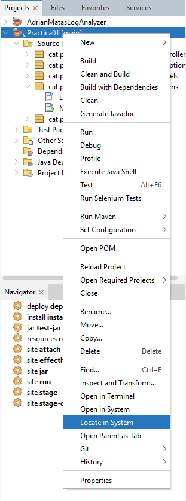
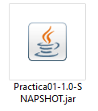

# Practica 1 d'interficies grafiques 

## Procés d'execució

A netbeans, pulsa el botó de **build** (o al seu defecte, pulsa F11).

Fes click dret al projecte, i pressiona "Locate in System".

Ves a la carpeta del projecte, "target", i fes doble click a l'arxiu .jar generat.

